# 绿宝石经济 · Emerald Economy

> Minecraft Java 版 **1.21.1** + **NeoForge** 的经济玩法模组：把绿宝石变成真正的货币，
> 围绕一个**统一的玩家账户**搭出六套互相打通的经济系统。
>
> 模组 ID：`emerald_economy` · 包名：`cn.daenx.mc.emeraldeconomy`

---

## 这是什么

服务器里的绿宝石通常只是「一种可以交易的材料」。这个模组把它变成**货币本身**：
所有玩法最终都从同一个账户里扣钱、进钱，形成一个闭环。

1. 把背包里的绿宝石通过 **ATM** 存进账户（收 1% 手续费）。
2. 用余额去 **基金交易所** 买卖七支基金赚差价（行情会被挖矿、伐木、收割、打怪、
   村民交易与当天的天气推动）。
3. 用余额去 **抽奖机** 下注，次日结算时开奖。
4. 用余额在 **自动售货机** 买满级附魔书、种子与树苗。
5. 把挖到 / 种出 / 打到的物品卖给 **自动收购机**，逢 5 的日子还有「疯狂星期五」高价收购。
6. 缺钱可以 **贷款**，每天结算时计息；**欠款没还清之前不能抽奖，也不能参加疯狂星期五**。

所有机器都必须放在**红石块正上方**才能使用，否则右键会提示「未接通红石电源」。

<table>
<tr>
<td align="center"><br><b>ATM 存取款机</b><br>高位屏幕 + 数字键盘 + 出钞口</td>
<td align="center">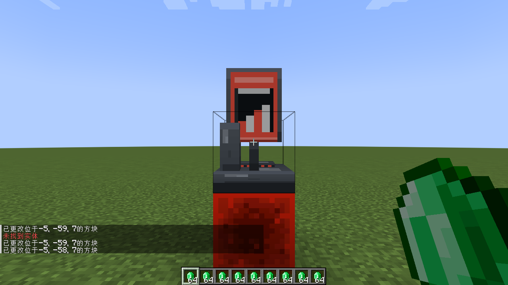<br><b>交易所电脑</b><br>显示器 + 键盘 + 主机箱</td>
</tr>
<tr>
<td align="center">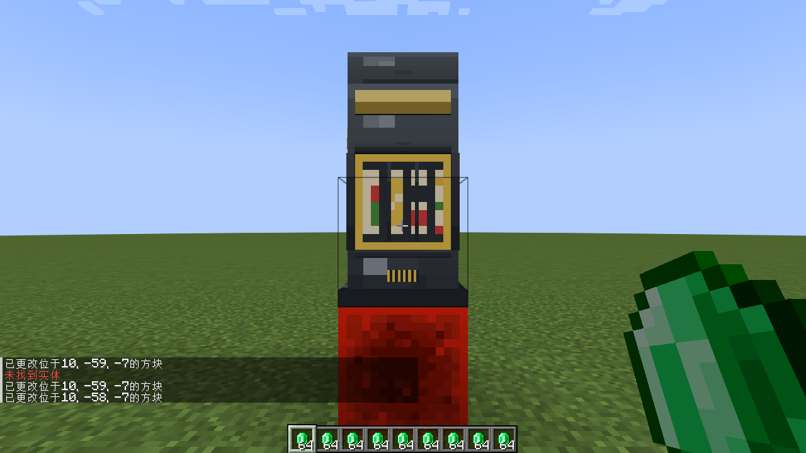<br><b>抽奖机</b><br>三滚轮窗口 + 右侧拉杆 + 顶部灯带</td>
<td align="center">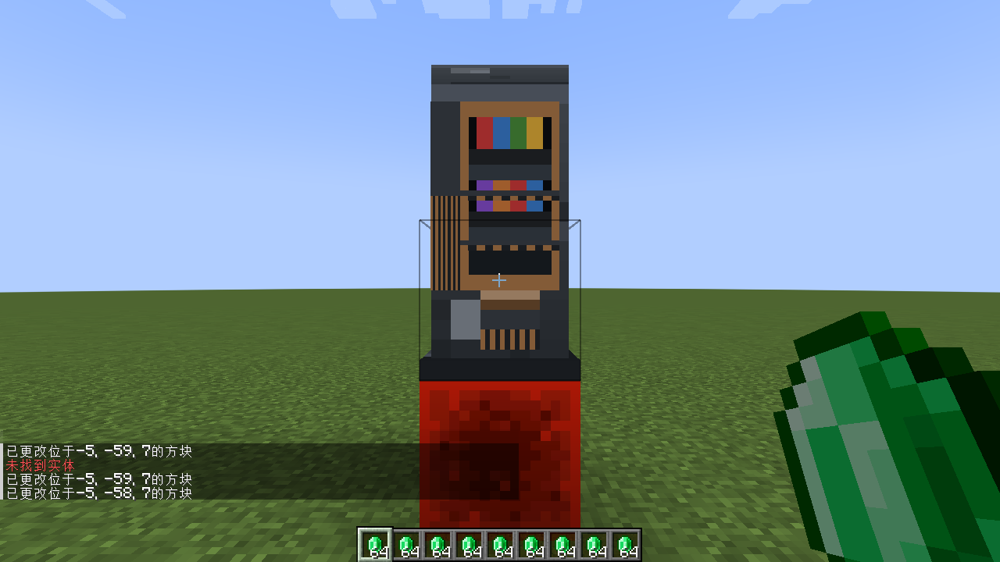<br><b>自动售货机</b><br>货架展示 + 操作柱 + 取物口</td>
</tr>
<tr>
<td align="center">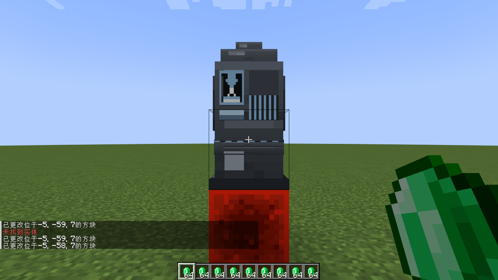<br><b>自动收购机</b><br>顶部漏斗 + 传送带 + 投料口</td>
<td></td>
</tr>
</table>

---

## 快速开始

```bash
# 编译（产物在 build/libs/，build.bat 会再复制一份到 build/）
./gradlew build          # 或者直接双击 build.bat

# 启动开发用服务端（会自动跑一遍引擎自检，结果打印在控制台）
./gradlew runServer

# 启动客户端
./gradlew runClient
```

装到正式客户端 / 服务器：把 `build/libs/emerald_economy-<版本>.jar` 丢进 `mods/` 即可
（需要 NeoForge 21.1.x for Minecraft 1.21.1）。

**第一次进游戏怎么玩**：

1. 合成：五台机器的配方都是「八种红石元件围着一个核心物品」，
   例如 ATM 的中间是绿宝石、交易所电脑是红石灯、抽奖机是时钟、售货机是展示框、收购机是炼药锅。
   首次拿到红石就会解锁全部五个配方（配方书里能直接搜到）。
2. 在红石块上放机器（**必须**），右键打开界面。
3. 想快速试玩：`/ee give @s 10000` 直接给账户打钱。

---

## 界面一览

<table>
<tr>
<td align="center">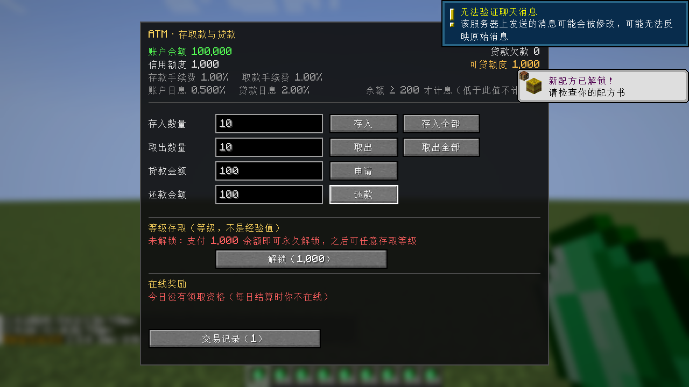<br><b>ATM</b>：存 / 取 / 存全部 / 取全部 / 贷款 / 还款</td>
<td align="center">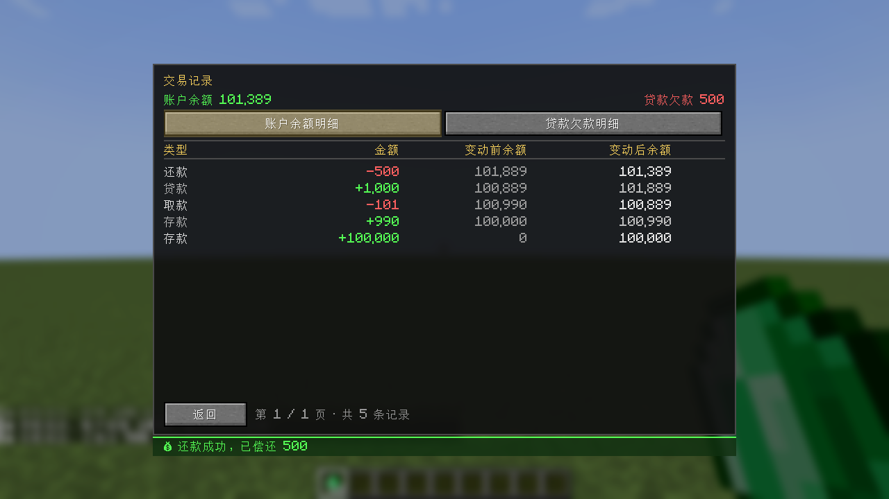<br><b>交易记录</b>：账户余额明细，含变动前 → 变动后</td>
</tr>
<tr>
<td align="center">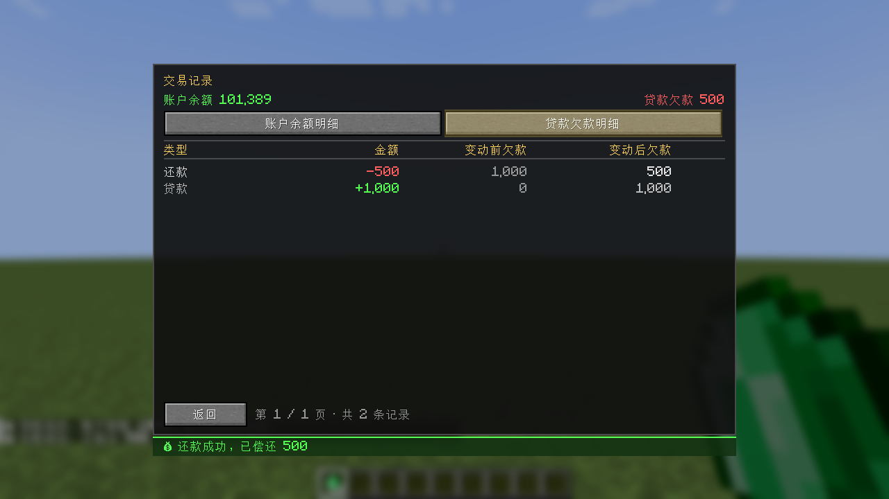<br><b>交易记录·贷款欠款明细</b>（两个分类分开看）</td>
<td align="center">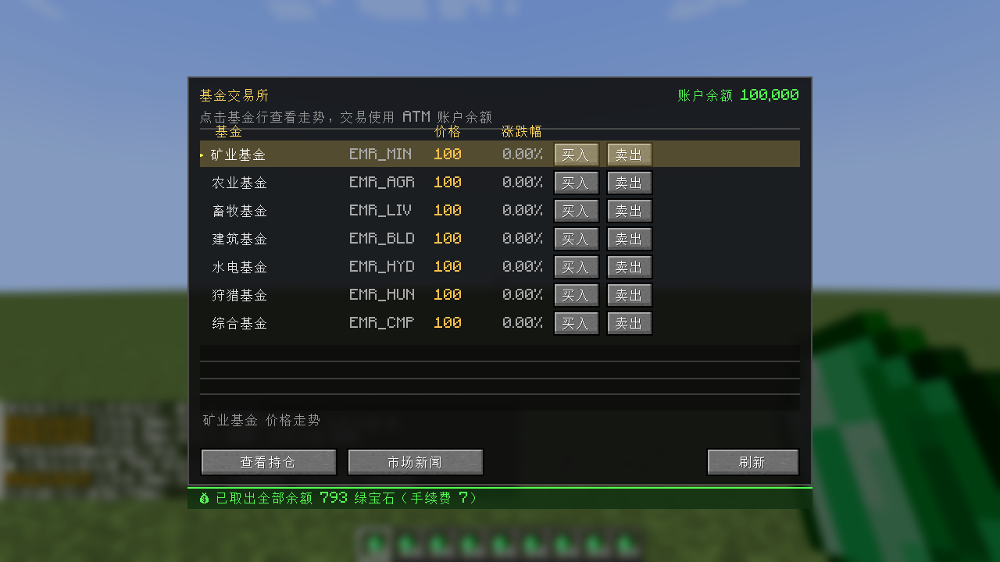<br><b>基金交易所</b>：七支基金的价格、涨跌幅与走势图</td>
</tr>
<tr>
<td align="center">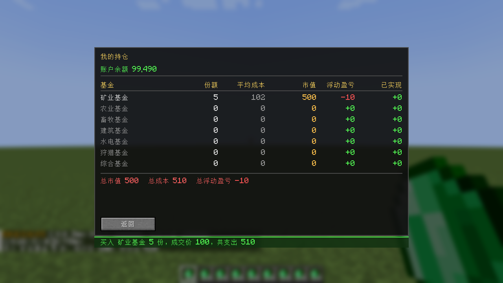<br><b>我的持仓</b>：份额 / 平均成本 / 市值 / 浮动盈亏</td>
<td align="center">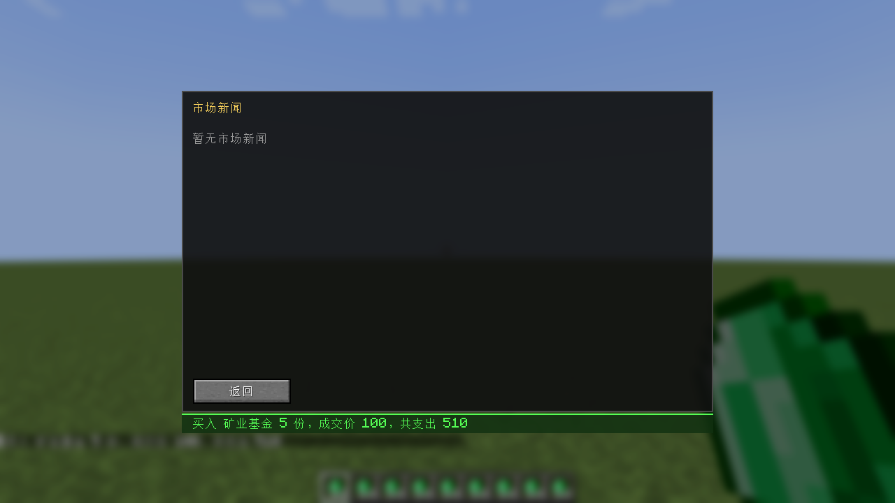<br><b>市场新闻</b>：天气与随机事件</td>
</tr>
<tr>
<td align="center"><br><b>抽奖机</b>：三个场次；欠款未清时不能下注</td>
<td align="center">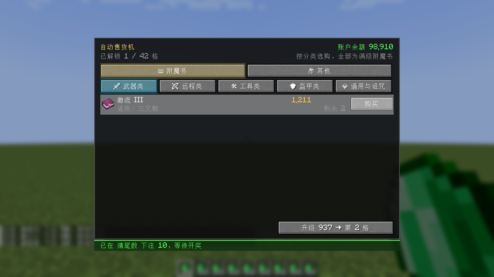<br><b>自动售货机</b>：附魔书按分类排版，带等级与适用物品</td>
</tr>
<tr>
<td align="center"><br><b>售货机·其他</b>：种子 / 树苗（不参与解锁进度）</td>
<td align="center">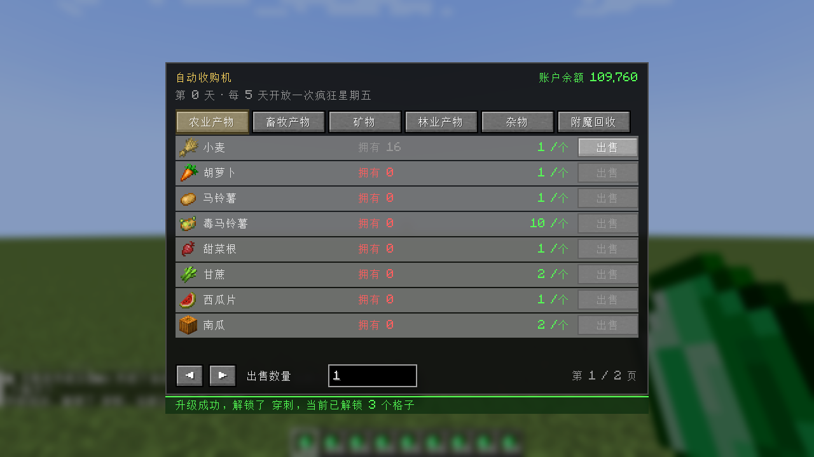<br><b>自动收购机</b>：五个常驻分类 + 疯狂星期五</td>
</tr>
<tr>
<td align="center">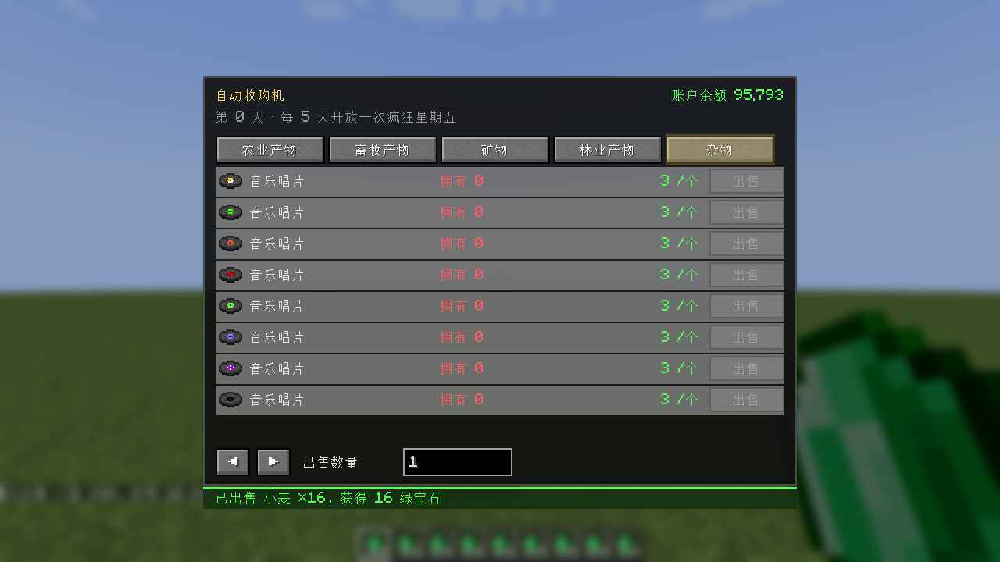<br><b>杂物分类</b>：山羊角 / 唱片 / 潜影壳 / 马铠……</td>
<td align="center">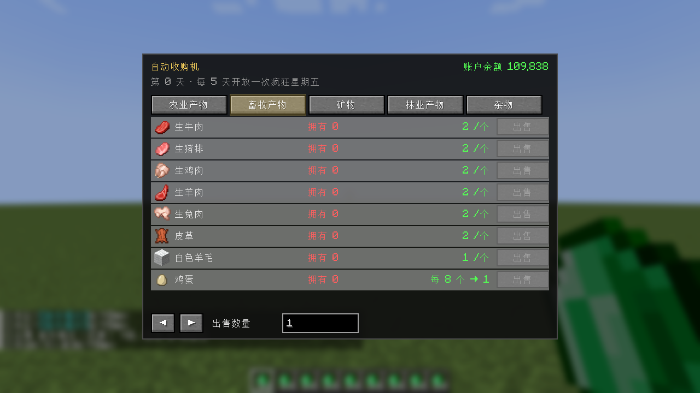<br><b>畜牧分类</b>：鱼肉类、骨粉、鸡蛋每 8 个一份</td>
</tr>
<tr>
<td align="center">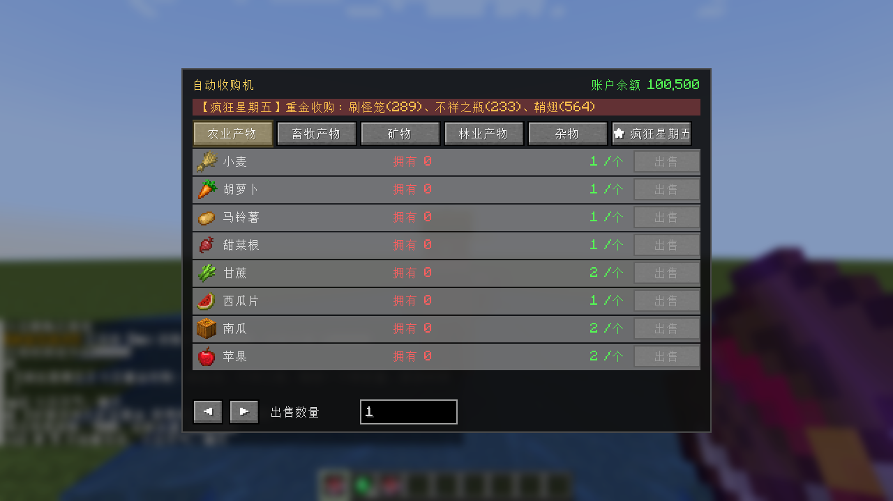<br><b>疯狂星期五</b>：逢 5 的游戏日，随机 3 件 5-10 倍收购</td>
<td align="center">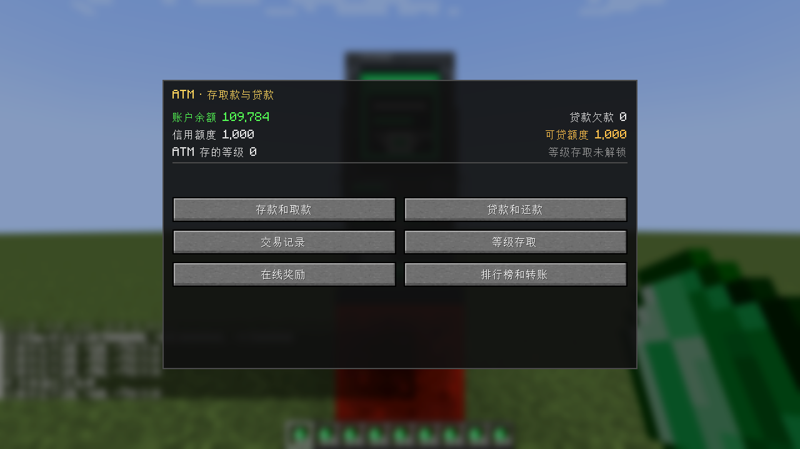<br><b>真实交互</b>：右键机器（需红石块供电）打开界面</td>
</tr>
</table>

---

## 玩法细则

### 统一账户
- 每个玩家一个账户：**余额 / 欠款（区分本金与利息）/ 信用额度 / 流水 / 基金持仓**，全部存进世界存档。
- 存取款各有 1% 手续费；**日息 0.500%，但余额 ≥ 200 才开始计息**（低于 200 不计息）。
- 贷款日息 2%（复利），信用额度默认 1000。

### ATM
- 「**存入全部**」把背包里的绿宝石一次性存完；「**取出全部**」把余额全部取成绿宝石，
  **背包放不下就整笔失败**（不会把绿宝石丢在地上）。
- 「交易记录」按钮进入流水界面，分成**账户余额明细**与**贷款欠款明细**两个分类，
  每条都显示**变动前 → 变动后**。

### 基金交易所
- 七支基金：矿业 / 农业 / 畜牧 / 建筑 / 水电 / 狩猎 + 综合（由前六支加权指数生成）。
- 价格引擎：动量衰减 → 偏离度 → 均值回归 → 随机噪声 → 动量约束 → 硬性边界，默认每 5 分钟更新一次。
- 世界供给会推动行情：挖矿、伐木、收割成熟作物、杀被动动物、杀怪物、倒水 / 倒熔岩、与村民交易。
- 买卖收 2% 手续费（最低 1），同一支基金 5 秒交易冷却。

### 抽奖机
- 三个场次：猜单双（1.95 倍）、猜大小（1.95 倍）、猜尾数（9.5 倍），每天每场次一次。
- 每日结算时开奖并全服广播；界面上的「上次开奖」会写清**这一期余额是加了还是没变、加了多少**。
- **还有贷款没还清时不能下注**（界面仍可打开看赔率与开奖结果）。

### 自动售货机
- **两大分类**：附魔书 / 其他。附魔书下面按 武器 / 远程 / 工具 / 盔甲 / 通用与诅咒 五个子分类排版，
  每一条显示**等级**与**适用物品**，价格来自配置里的分类区间（例如锋利 896-1280，风爆 1560-2560）。
- 附魔书格子要**全服一起花钱解锁**（每级 512-1280 随机，同一级价格固定），
  升级时会广播「解锁了哪个附魔」。
- 「其他」目前有种子（小麦种子 8/个）与树苗（橡树 / 白桦 16/个），不参与解锁进度，随时可买。
- 每个格子每人每天限购 2 次。

### 自动收购机
- 五个常驻分类：**农业产物 / 畜牧产物（含鱼肉类与骨头）/ 矿物（含下界合金碎片）/ 林业产物 / 杂物**
  （山羊角、音乐唱片、潜影壳、美西螈桶、海龟壳、马铠、粘液球、粘土球、烈焰棒、幻翼膜）。
  分类、物品、价格都能在 `acquire.json` 里自由增减。
- **背包里没有的物品，出售按钮是灰的**（每行还会显示「拥有 N」），
  数量不够「一份」的也一样点不动，不用点了才发现卖不掉。
- **批次收购**：鸡蛋、羽毛要凑够 **8 个**才算一份（8 个 = 1 绿宝石），竹子要凑够 **4 个**；
  界面上会写「每 8 个 → 1」。数量框里填的不足一份时，界面会**自动改成把手里的整份全卖掉**
  （框里的数字会跟着变），所以「我有 16 个鸡蛋」点一下出售就是卖 16 个、换 2 绿宝石。
- **疯狂星期五**：逢 5 的游戏日随机抽 3 件稀有物品按 5-10 倍收购并全服广播；
  **欠款没还清时不能参加**（列表照常显示，但点不到出售）。
- 收购所得直接进账户，不收手续费。

### 机器外观与挖掘
五台机器都是 **1×1×2 的两格方块**（正面朝向放置者），模型与贴图在 Blockbench 里制作，
工程文件放在 `素材/blockbench/*.bbmodel`，可以直接打开继续改。

挖掘手感和铁块一致（硬度 5.0）：**任意工具都能挖下来，镐子最快**，
生存模式破坏任意一半都恰好掉落一台机器（不会吞掉，也不会掉两份）。

---

## 配置

服务端配置：`<存档目录>/serverconfig/emerald_economy-server.toml`
（专用服务器在 `config/` 下；开发环境是 `run/config/`）。

游戏内：**ESC → 模组 → Emerald Economy → 配置**。
这个按钮**只有服主 / OP（权限等级 ≥ 2）能改**，其他玩家点开只会看到提示。

主要能调的东西：

| 节 | 内容 |
| --- | --- |
| `account` | 存取款手续费率、日息与**计息起算余额**、贷款日息、信用额度、保留流水条数 |
| `market` | 价格更新间隔、动量与回归参数、手续费、交易冷却、各基金基准价 / 波动率 / 供给量、天气表、新闻事件表 |
| `lottery` | 三个场次的赔率、每日下注次数 |
| `shop` | 初始格子数、升级费用区间、**附魔价格与分类总表**、其他商品表、每日限购、不售卖的附魔 |
| `acquire` | 五个分类的价格表、批次收购表、疯狂星期五间隔 / 物品池 / 基准价与倍率 |

### 卖什么 / 收什么：两份可以直接编辑的 JSON

自动售货机的货架和自动收购机的价格表放在 `config/emerald_economy/` 下（第一次启动自动生成）：

| 文件 | 能改什么 |
| --- | --- |
| `shop.json` | 「大分类 → 子分类 → 商品」。附魔书用 `enchants`（`id` + `min`/`max` 价格区间），普通商品用 `items`（`item` + `price`）。名字可以写翻译键 `lang`，也可以直接写 `name`（自己加的分类直接写中文名） |
| `acquire.json` | 「分类 → 条目」。每条形如 `{"item":"minecraft:wheat","price":1}`，或 `{"tag":"minecraft:saplings","price":1}` 收一整类（支持原版物品标签）；`"batch": 8` 表示 8 个算一份；末尾 `friday` 段是疯狂星期五的池子与基准价 |

**改完在游戏里执行 `/ee reload` 立刻生效**（不用重启；写错了会保留上一次的内容并在日志里报错）。

```jsonc
// shop.json 片段：加一个大分类 / 子分类 / 两件商品
{
  "groups": [
    { "id": "OTHER", "lang": "shop.group.other", "name": "其他", "icon": "📦", "unlockable": false,
      "subcategories": [
        { "id": "SEED", "name": "种子", "items": [ { "item": "minecraft:wheat_seeds", "price": 8 } ] }
      ] }
  ]
}

// acquire.json 片段：加一个分类，收所有树苗（每份 1 绿宝石）
{
  "categories": [
    { "id": "AGRICULTURE", "name": "农业产物",
      "items": [ { "item": "minecraft:wheat", "price": 1 },
                 { "tag": "minecraft:saplings", "price": 1 },
                 { "item": "minecraft:bamboo", "price": 1, "batch": 4 } ] }
  ]
}
```

两份文件的默认模板在模组 jar 里（`data/emerald_economy/economy/`），
生成脚本是 `tools/gen_economy_json.py`。

其余用 `key=value` 字符串列表表示的表格（天气修正、随机事件、基金参数）仍写在 TOML 里：

```toml
weatherModifiers = ["RAIN:EMR_AGR=0.08", "THUNDER:EMR_HYD=0.090"]
marketEvents = ["EMR_MIN|0.08|news.vein_found", "ALL|-0.06|news.recession"]
```

> **改了默认值之后记得删旧配置**：NeoForge 只在「缺少某个键」时写入默认值，
> 已经存在的键会一直沿用文件里的旧值。删掉 `emerald_economy-server.toml`（先备份）再启动即可。

---

## 游戏内命令（需要 OP）

| 命令 | 作用 |
| --- | --- |
| `/ee balance [玩家]` | 查看账户余额 / 欠款 / 信用额度 |
| `/ee give <玩家> <数量>` / `/ee take <玩家> <数量>` | 直接增减账户余额 |
| `/ee price` | 打印七支基金的价格、基准价、涨跌幅、动量 |
| `/ee tick` | 强制刷新一次基金价格 |
| `/ee settle` | **强制跑一次每日结算**（立刻看到开奖、利息、新闻广播） |
| `/ee supply` | 查看当日各行业供给量与当前天气 |
| `/ee friday` | 查看疯狂星期五状态 |
| `/ee setprice <基金代码> <价格>` | 直接设定某支基金价格 |
| `/ee shop reset` | 重置商店限购次数 |
| `/ee reload` | **重新读取 `shop.json` / `acquire.json`**（改完货架与价格表不用重启） |

---

## 开发

```bash
./gradlew build                    # 编译
python tools/gen_resources.py      # 重新生成方块状态 / 模型 / 配方 / 战利品表 / 配方解锁进度 / 收购标签
python tools/gen_bbmodel.py        # 用同一份几何生成 Blockbench 工程（素材/blockbench/*.bbmodel）
python tools/gen_economy_json.py   # 重新生成内容配置的默认模板（shop.json / acquire.json）
python tools/check_lang.py         # 校验中英翻译键是否齐全（含配置界面）
python tools/setup-dev-server.py   # 一键摆好 run/（超平坦 + 创造 + OP），删过 run/ 之后必须跑一次
java tools/TextureGenerator.java   # 从 素材/logo.png 生成模组图标（抠白底 + 缩放到 256）
```

**机器模型的单一真源**是 `tools/gen_resources.py` 里的 `machine_elements()`；
想用 Blockbench 手工改，就用 `素材/blockbench/*.bbmodel` 打开，改完把几何回填到脚本里。

### 自动化验证

```bash
python tools/setup-dev-server.py   # 只跑一次；删过 run/ 之后要重跑
rm -rf run/world                   # 主用例断言的是绝对余额，必须用干净存档
./gradlew runServer                # 终端 1
./gradlew runClientUiTest          # 终端 2：真连服务端，真点按钮，最后截图
```

- `SelfTest`（`runServer` 自带 `-Dee.selftest=true`）在服务端启动时跑 **95 项**纯逻辑断言。
- `ClientUiTest` 主用例 **123 项断言 / 38 张截图**，覆盖九个界面的打开与点击、
  五台机器的红石块供电门控、七类世界事件供给、交易冷却、失败路径与规则性拒绝、
  批量收购与批次结算、欠款禁赌 / 禁止参加疯狂星期五、交易记录的前后余额、
  收购按钮按背包置灰、改 JSON + `/ee reload` 热重载、生存模式挖机器必定掉一台等。
- 另有四个专用用例：`runClientUiTestShopFull`（商店全解锁）、`runClientUiTestMarketEvents`
  （随机市场事件逐类核对）、`runClientUiTestOwner` + `runClientUiTestPeer`（两人同时在线）、
  `runClientUiTestMine`（只跑挖掘与掉落，排查问题时几十秒出结果）。

截图留档：`素材/验证截图/`（全量）与 `素材/README截图/`（本 README 用的那些）。

更细的开发笔记、需求取舍与踩过的坑都写在 [JOB.md](JOB.md)。
