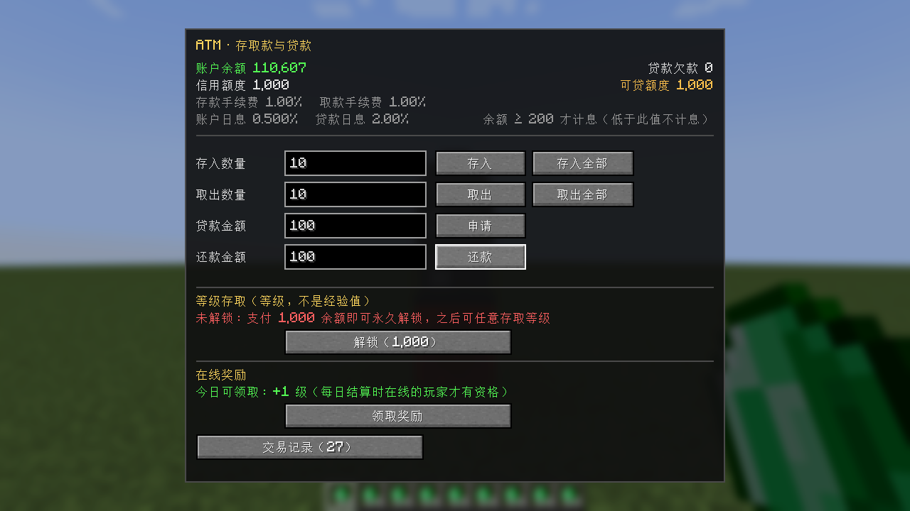
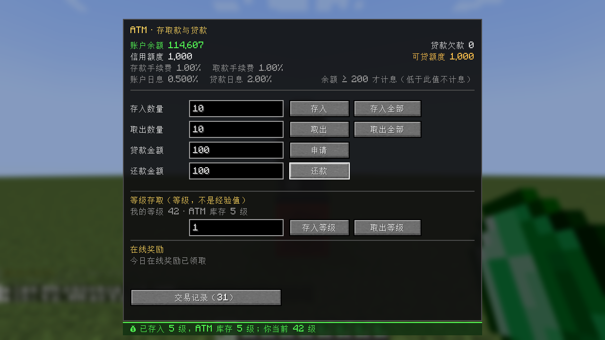
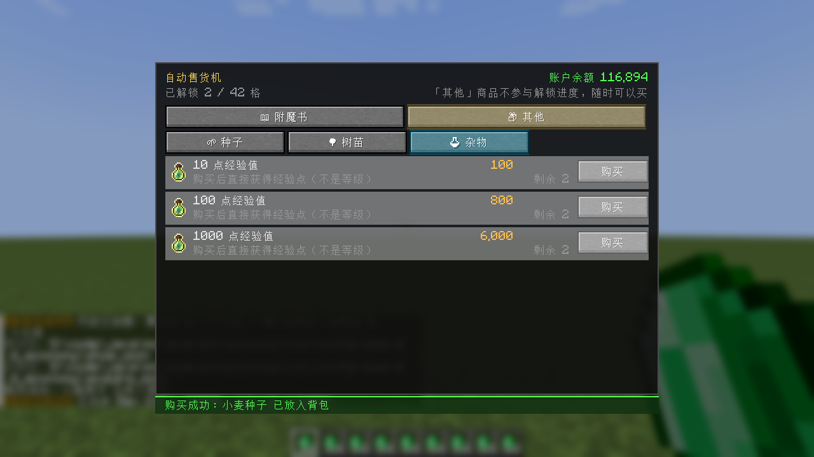
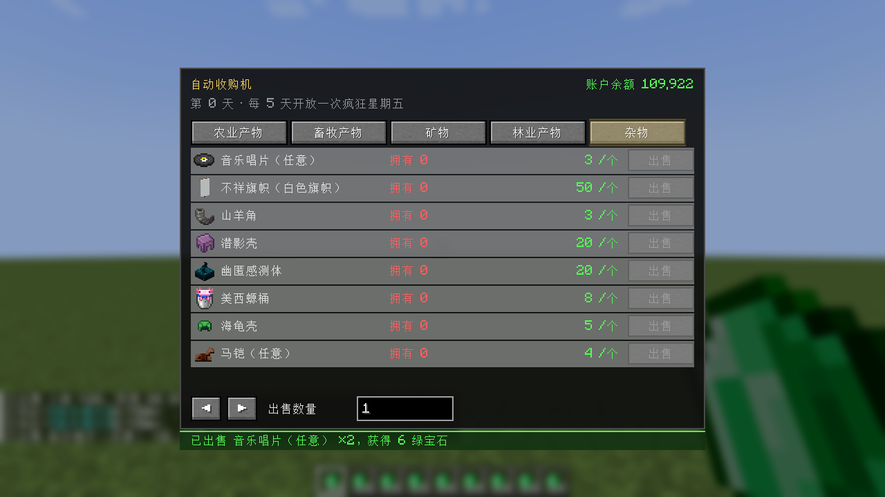

[简体中文](README.md) | **English**

# Emerald Economy

[Download on Modrinth](https://modrinth.com/mod/emerald-economy-daenmax) · [Source on GitHub](https://github.com/daenmax/emerald-economy)

> An economy gameplay mod for **Minecraft Java 1.21.1** on **NeoForge**: it turns the emerald into real
> currency and builds six interconnected economic systems around one **shared player account**.
>
> Mod ID: `emerald_economy` · Package: `cn.daenx.mc.emeraldeconomy`

---

## What is this

On most servers an emerald is just "a material you can trade with". This mod makes it **the currency itself**:
every feature ultimately spends from and earns into the same account, forming a closed loop.

1. Deposit the emeralds in your inventory into your account at the **ATM** (1% fee). The ATM also lets
   you **store/withdraw experience levels** and claim a daily **online reward**.
2. Trade seven funds on the **Fund Exchange** to profit from price swings — prices are pushed by mining,
   logging, harvesting, mob kills, villager trades and the day's weather, plus a
   **random ±5% mood correction every day**, so no fund is a guaranteed riser.
3. Bet your balance on the **Lottery Machine**; the draw happens at the next daily settlement.
4. Spend your balance at the **Vending Machine** on max-level enchanted books, seeds, saplings and
   **XP points**.
5. Sell what you mine, farm and kill to the **Acquisition Machine** — and on every 5th game day,
   **Crazy Friday** pays 5–10× for a few rare items.
6. Short on cash? Take a **loan**; interest is charged at each daily settlement.
   **Until the debt is repaid you cannot bet, and you cannot join Crazy Friday.**

Every machine must be placed **directly on top of a redstone block**, otherwise right-clicking it says
"Not connected to a redstone power source".

<table>
<tr>
<td align="center"><br><b>ATM</b><br>High-mounted screen + keypad + cash slot</td>
<td align="center"><br><b>Exchange Terminal</b><br>Monitor + keyboard + tower case</td>
</tr>
<tr>
<td align="center"><br><b>Lottery Machine</b><br>Three reels + side lever + light strip on top</td>
<td align="center"><br><b>Vending Machine</b><br>Shelf display + control column + pickup slot</td>
</tr>
<tr>
<td align="center"><br><b>Acquisition Machine</b><br>Top hopper + conveyor belt + intake</td>
<td></td>
</tr>
</table>

---

## Quick start

```bash
# Build (output lands in build/libs/; build.bat also copies it into build/)
./gradlew build          # or just double-click build.bat

# Start the dev server (it runs the engine self-test and prints the result)
./gradlew runServer

# Start the client
./gradlew runClient
```

To install on a real client / server, drop `build/libs/emerald_economy-<version>.jar` into `mods/`
(requires NeoForge 21.1.x for Minecraft 1.21.1).

**Your first time in game**:

1. Crafting: all five machines share **one recipe** and differ only in the center slot — see
   **Crafting recipes** below. Picking up redstone for the first time unlocks all five recipes
   (searchable in the recipe book).
2. Place a machine on a redstone block (**required**) and right-click it to open its screen.
3. Want to try things out fast: `/ee give @s 10000` puts money straight into your account.

---

## Crafting recipes

All five machines share **one recipe**; only the center slot changes — eight redstone components
surrounding each machine's own core item.

|  |  |  |
| :---: | :---: | :---: |
| Redstone Dust | Sticky Piston | Hopper |
| Observer | **Core item** | Lever |
| Redstone Repeater | Chest | Redstone Comparator |

The core item for each machine (the center slot):

| Machine | Core item |
| --- | --- |
| ATM | Emerald |
| Exchange Terminal | Redstone Lamp |
| Lottery Machine | Clock |
| Vending Machine | Item Frame |
| Acquisition Machine | Cauldron |

Each recipe yields one machine. Picking up redstone for the first time unlocks all five, and searching
"emerald" in the recipe book finds them too.

---

## Screen gallery

<table>
<tr>
<td align="center"><br><b>ATM</b>: deposit / withdraw / deposit all / withdraw all / loan / repay / level storage / online reward</td>
<td align="center"><br><b>Transactions</b>: balance details, with before &rarr; after</td>
</tr>
<tr>
<td align="center"><br><b>ATM &middot; Online reward</b>: online at settlement, claim +1 level per day</td>
<td align="center"><br><b>ATM &middot; Level storage</b>: pay once, then store/withdraw levels freely</td>
</tr>
<tr>
<td align="center"><br><b>Transactions &middot; Debt details</b> (the two categories are kept apart)</td>
<td align="center"><br><b>Fund Exchange</b>: seven funds with price, change and chart</td>
</tr>
<tr>
<td align="center"><br><b>My holdings</b>: shares / average cost / market value / unrealized P&L</td>
<td align="center"><br><b>Market news</b>: weather and random events</td>
</tr>
<tr>
<td align="center"><br><b>Lottery Machine</b>: three games; betting is blocked while you owe money</td>
<td align="center"><br><b>Vending Machine</b>: enchanted books by category, with level and applicable items</td>
</tr>
<tr>
<td align="center"><br><b>Vending Machine &middot; Other</b>: seeds / saplings / misc (no unlock progression)</td>
<td align="center"><br><b>Acquisition Machine</b>: five permanent categories + Crazy Friday</td>
</tr>
<tr>
<td align="center"><br><b>Vending Machine &middot; Misc</b>: 10 / 100 / 1000 XP points</td>
<td align="center"><br><b>Acquisition &middot; whole-tag row</b>: music discs take one row, any disc sells</td>
</tr>
<tr>
<td align="center"><br><b>Miscellaneous</b>: ominous banner / music discs / shulker shell / sculk sensor&hellip;</td>
<td align="center"><br><b>Livestock</b>: fish and meat, bone, eggs in batches of 8</td>
</tr>
<tr>
<td align="center"><br><b>Crazy Friday</b>: every 5th game day, three random items at 5–10×</td>
<td align="center"><br><b>Real interaction</b>: right-click a machine (needs redstone power) to open it</td>
</tr>
</table>

---

## Gameplay details

### Shared account
- One account per player: **balance / debt (principal and interest tracked separately) / credit limit /
  transaction history / fund holdings**, all persisted in the world save.
- Deposits and withdrawals each cost a 1% fee. **Daily interest is 0.500%, and only starts at a balance
  of 200** (below that, none).
- Loans charge 2% daily interest (compounded); the default credit limit is 1000.

### ATM
- **Deposit all** moves every emerald in your inventory into the account in one go; **Withdraw all** turns
  your whole balance back into emeralds and **fails as a whole if your inventory cannot hold them**
  (nothing is dropped on the ground).
- The **Transactions** button opens the history screen, split into **Balance details** and
  **Debt details**; every entry shows **before &rarr; after**. Level-storage entries appear here too
  (their amount column is in **levels**).
- **Level storage** (off by default): it moves **levels**, not XP. Storing 5 levels drops you 5 levels and
  puts 5 levels into the ATM; withdrawing 5 levels adds 5 levels to you (35 &rarr; 36). Every player must
  **unlock it for 1000** first, after which there are no limits: you cannot store more than your current
  level, nor withdraw more than the ATM holds.
- **Online reward**: eligibility is reset at the moment interest is settled each day, and **only players
  online at that moment** get it for that day (offline means no eligibility, and no claiming it later);
  the reward is **+1 level**, claimable once per day. The screen states whether it is claimable, already
  claimed, or unavailable today.

### Fund Exchange
- Seven funds: Mining / Agriculture / Livestock / Building / Hydro Power / Hunting, plus a Composite
  (a weighted index of the first six).
- Price engine: momentum decay &rarr; deviation &rarr; mean reversion &rarr; random noise &rarr; momentum
  clamp &rarr; hard bounds; it refreshes every 5 minutes by default.
- World supply moves the market: mining, logging, harvesting ripe crops, killing passive animals,
  killing monsters, pouring water / lava, and villager trades.
- **Every settlement also rolls a ±5% random mood correction per fund** (`dailyRandomDrift`): even if
  nobody does anything, prices still move, and no fund can trend in one direction forever — so
  "buy whatever is rising and do nothing" cannot work.
- Trades cost a 2% fee (minimum 1), with a 5-second cooldown per fund.

### Lottery Machine
- Three games: Odd / Even (1.95×), Small / Big (1.95×) and Last digit 0-9 (9.5×); one bet per game per day.
- The draw happens at the daily settlement and is broadcast server-wide; the "last draw" line spells out
  **whether this round's balance grew, and by how much**.
- **You cannot bet while a loan is unpaid** (the screen still opens, so odds and results stay visible).

### Vending Machine
- **Two groups**: Enchanted Books / Other. Books are laid out in five subcategories — Weapons / Ranged /
  Tools / Armor / General &amp; Curses — and each entry shows its **level** and **applicable items**.
  Prices come from the per-category ranges in the config (for example Sharpness 896-1280,
  Wind Burst 1560-2560).
- Book slots must be **unlocked by pooling money server-wide** (512-1280 per level, fixed for a given
  level); unlocking broadcasts which enchantment was unlocked.
- **Other** has three subcategories: **Seeds** (wheat seeds 8 each), **Saplings** (oak / birch 16 each) and
  **Misc**, which sells **XP points**: 10 points for 100, 100 for 800, 1000 for 6000. They ignore the unlock
  progression and are always available.
- XP goods give **experience points, not levels**: 1000 points is roughly what it takes to go from level 0
  to level 26 (for reference, level 0 to 30 needs 1395 points). The points go straight onto your XP bar.
- Each slot is limited to 2 purchases per player per day.

### Acquisition Machine
- Five permanent categories: **Farm Produce / Livestock Produce (fish and meat, plus bone) /
  Minerals (including netherite scrap) / Forestry Produce (logs plus saplings, flowers, mushrooms,
  cactus) / Miscellaneous**. Categories, items and prices can be added or removed freely in
  `acquire.json`; the full default price list is in **Default values and price lists** below.
- **Whole-tag rows take a single line**: music discs (any disc, 3 each), saplings, flowers, mushrooms and
  horse armors each occupy one row instead of listing dozens of individual items. Selling accepts any item
  from that class, and you can even mix several kinds in one sale.
- **Items you do not have are greyed out** (each row also shows "Owned N"), and quantities below one full
  batch cannot be sold either — no more clicking just to be told no.
- **Batch buyout**: eggs and feathers need **8** for one batch (8 = 1 emerald), bamboo needs **4**;
  the screen writes it as "per 8 &rarr; 1". If the amount box holds less than one batch, the screen
  **switches to selling every full batch you have** (the number in the box follows along), so "I have
  16 eggs" plus one click sells 16 eggs for 2 emeralds.
- **Crazy Friday**: on every 5th game day, three rare items are picked at random and bought at 5–10×,
  and the broadcast **includes the price of every item**. Besides single items (nether star, elytra,
  trident, heart of the sea, echo shard, monster spawner, ominous bottle) the pool holds two
  "whole class" entries (one random pick from the whole class):
  - **All mob heads**: skeleton skull, wither skeleton skull, zombie head, creeper head, piglin head and
    **dragon head** — six kinds (the dragon head lives inside this entry now: no separate line, no
    separate roll), base price **83**;
  - **All spawn eggs**: matched by wildcard (`*_spawn_egg`), so a mob added by a future update is picked
    up automatically, base price **52**.
  **You cannot take part while a loan is unpaid** (the list still shows, but Sell is not clickable).
- Buyout earnings go straight into your account, with no fee.

### Machine looks and mining
All five machines are **1×1×2 two-block-tall blocks** (facing whoever placed them). Models and textures are
made in Blockbench; the project files live in `素材/blockbench/*.bbmodel` and can be opened and edited
directly.

They mine like an iron block (hardness 5.0): **any tool works, a pickaxe is fastest**, and in survival
breaking either half drops exactly one machine (never lost, never doubled).

---

## Default values and price lists

Everything below is **the mod's own default configuration**, generated by
`tools/gen_readme_tables.py` straight from `EEConfig.java` and `tools/gen_economy_json.py`
(nothing is copied by hand). After changing a default, re-run the script and replace this section.
Values inside an existing save / config file are not updated automatically — see the note under
**Configuration**.

### ATM / account
| Item | Default |
| --- | --- |
| Deposit fee | 1.00% |
| Withdraw fee | 1.00% |
| Daily balance interest | 0.500% |
| Interest threshold | 200 |
| Loan interest (compound) | 2.00% |
| Credit limit | 1000 |
| Records kept | 100 |
| Level storage unlock (once per player) | 1000 |
| Online reward levels | 1 level(s) per day (online at settlement required) |

### Fund exchange
| Fund | Base price | Volatility | Mean reversion | Expected daily supply |
| --- | --- | --- | --- | --- |
| Mining | 100 | 6.0% | 3.0% | 800 |
| Farming | 80 | 4.5% | 2.5% | 1200 |
| Livestock | 90 | 4.0% | 2.2% | 600 |
| Building | 70 | 3.5% | 2.0% | 1500 |
| Hydro | 85 | 5.0% | 2.5% | 700 |
| Hunting | 95 | 5.5% | 2.8% | 500 |
| Composite | 100 | 2.0% | 2.0% | 200 |

| Item | Default |
| --- | --- |
| Price bounds | base × 0.3 ~ × 3.0 |
| Price update interval | 6000 ticks (5 in-game minutes) |
| Momentum decay | 0.95 |
| Max momentum | 15.0% |
| World event sensitivity | 0.05 |
| Weather strength | 1 |
| Daily random drift (rolled per fund) | ±5.0% |
| Random market event chance | 15% |
| Fund trade fee | 2% (minimum 1) |
| Trade cooldown per fund | 5000 ms |

### Lottery
| Game | Odds | Bets per day |
| --- | --- | --- |
| Odd or even | 1.95 | 1 |
| Big or small | 1.95 | 1 |
| Last digit | 9.50 | 1 |

### Vending machine
| Item | Default |
| --- | --- |
| Initial unlocked slots | 1 |
| Daily purchase limit per good | 2 |
| Upgrade cost (stable per level) | 512 - 1280 |
| Fallback price for unlisted enchants | 256 - 1280 |
| Fallback treasure multiplier | ×3 - ×5 |

**Enchanted book prices** (max level books; the price is stable per enchant id)
| Category | Enchant (max level) | Price range |
| --- | --- | --- |
| Weapon | Sharpness 5 | 896 - 1280 |
| Weapon | Smite 5 | 896 - 1280 |
| Weapon | Bane of Arthropods 5 | 896 - 1280 |
| Weapon | Sweeping Edge 3 | 896 - 1280 |
| Weapon | Knockback 2 | 896 - 1280 |
| Weapon | Fire Aspect 2 | 896 - 1280 |
| Weapon | Looting 3 | 896 - 1280 |
| Weapon | Impaling 5 | 256 - 640 |
| Weapon | Loyalty 3 | 384 - 768 |
| Weapon | Channeling 1 | 896 - 1280 |
| Weapon | Riptide 3 | 896 - 1280 |
| Weapon | Breach 4 | 896 - 1280 |
| Weapon | Density 5 | 896 - 1280 |
| Weapon | Wind Burst 3 | 1560 - 2560 |
| Ranged | Power 5 | 896 - 1280 |
| Ranged | Punch 2 | 512 - 896 |
| Ranged | Flame 1 | 896 - 1280 |
| Ranged | Infinity 1 | 896 - 1280 |
| Ranged | Piercing 4 | 320 - 704 |
| Ranged | Quick Charge 3 | 384 - 768 |
| Ranged | Multishot 1 | 896 - 1280 |
| Tool | Efficiency 5 | 896 - 1280 |
| Tool | Silk Touch 1 | 896 - 1280 |
| Tool | Fortune 3 | 896 - 1280 |
| Tool | Luck of the Sea 3 | 384 - 768 |
| Tool | Lure 3 | 384 - 768 |
| Armor | Protection 4 | 896 - 1280 |
| Armor | Fire Protection 4 | 896 - 1280 |
| Armor | Blast Protection 4 | 896 - 1280 |
| Armor | Projectile Protection 4 | 896 - 1280 |
| Armor | Feather Falling 4 | 896 - 1280 |
| Armor | Depth Strider 3 | 896 - 1280 |
| Armor | Frost Walker 2 | 1560 - 2560 |
| Armor | Soul Speed 3 | 1560 - 2560 |
| Armor | Respiration 3 | 896 - 1280 |
| Armor | Aqua Affinity 1 | 896 - 1280 |
| Armor | Swift Sneak 3 | 1560 - 2560 |
| Armor | Thorns 3 | 896 - 1280 |
| Generic | Unbreaking 3 | 896 - 1280 |
| Generic | Mending 1 | 1560 - 2560 |
| Generic | Curse of Binding 1 | 1560 - 2560 |
| Generic | Curse of Vanishing 1 | 1560 - 2560 |

**"Other" shelf goods** (fixed prices)
| Subcategory | Good | Price |
| --- | --- | --- |
| Seeds | Wheat Seeds | 8 |
| Saplings | Oak Sapling | 16 |
| Saplings | Birch Sapling | 16 |
| Misc | 10 XP points | 100 |
| Misc | 100 XP points | 800 |
| Misc | 1000 XP points | 6000 |

### Acquisition machine
| Item | Default |
| --- | --- |
| Crazy Friday interval | every 5 game days |
| Premium items picked per day | 3 |
| Daily multiplier | ×5 - ×10 |

**Buyout prices by category** (price per unit; batch = items per unit)
| Category | Item / whole tag | Price | Batch |
| --- | --- | --- | --- |
| Farm produce | Wheat | 1 | 1 |
| Farm produce | Carrot | 1 | 1 |
| Farm produce | Potato | 1 | 1 |
| Farm produce | Poisonous Potato | 10 | 1 |
| Farm produce | Beetroot | 1 | 1 |
| Farm produce | Sugar Cane | 2 | 1 |
| Farm produce | Melon Slice | 1 | 1 |
| Farm produce | Pumpkin | 2 | 1 |
| Farm produce | Apple | 2 | 1 |
| Farm produce | Sweet Berries | 1 | 1 |
| Farm produce | Nether Wart | 2 | 1 |
| Farm produce | Bamboo | 1 | 4 |
| Farm produce | Cocoa Beans | 1 | 1 |
| Livestock produce | Raw Beef | 2 | 1 |
| Livestock produce | Raw Porkchop | 2 | 1 |
| Livestock produce | Raw Chicken | 2 | 1 |
| Livestock produce | Raw Mutton | 2 | 1 |
| Livestock produce | Raw Rabbit | 2 | 1 |
| Livestock produce | Leather | 2 | 1 |
| Livestock produce | White Wool | 1 | 1 |
| Livestock produce | Egg | 1 | 8 |
| Livestock produce | Milk Bucket | 3 | 1 |
| Livestock produce | Honey Bottle | 3 | 1 |
| Livestock produce | Feather | 1 | 8 |
| Livestock produce | Bone | 1 | 1 |
| Livestock produce | Fish (any) | 2 | 1 |
| Minerals | Coal | 1 | 1 |
| Minerals | Raw Iron | 2 | 1 |
| Minerals | Raw Copper | 2 | 1 |
| Minerals | Raw Gold | 4 | 1 |
| Minerals | Redstone Dust | 1 | 1 |
| Minerals | Lapis Lazuli | 2 | 1 |
| Minerals | Diamond | 15 | 1 |
| Minerals | Nether Quartz | 1 | 1 |
| Minerals | Amethyst Shard | 2 | 1 |
| Minerals | Flint | 1 | 1 |
| Minerals | Obsidian | 3 | 1 |
| Minerals | Netherite Scrap | 10 | 1 |
| Forestry produce | Oak Log | 1 | 1 |
| Forestry produce | Spruce Log | 1 | 1 |
| Forestry produce | Birch Log | 1 | 1 |
| Forestry produce | Jungle Log | 1 | 1 |
| Forestry produce | Acacia Log | 1 | 1 |
| Forestry produce | Dark Oak Log | 1 | 1 |
| Forestry produce | Mangrove Log | 1 | 1 |
| Forestry produce | Cherry Log | 1 | 1 |
| Forestry produce | Block of Bamboo | 1 | 1 |
| Forestry produce | Crimson Stem | 1 | 1 |
| Forestry produce | Warped Stem | 1 | 1 |
| Forestry produce | Sapling (any) | 1 | 1 |
| Forestry produce | Flower (any) | 1 | 1 |
| Forestry produce | Mushroom (any) | 1 | 1 |
| Forestry produce | Cactus | 1 | 1 |
| Misc | Music disc (any) | 3 | 1 |
| Misc | Ominous Banner (white banner) | 50 | 1 |
| Misc | Goat Horn | 3 | 1 |
| Misc | Shulker Shell | 20 | 1 |
| Misc | Sculk Sensor | 20 | 1 |
| Misc | Bucket of Axolotl | 8 | 1 |
| Misc | Turtle Shell | 5 | 1 |
| Misc | Horse armor (any) | 4 | 1 |
| Misc | Ghast Tear | 20 | 1 |
| Misc | Slimeball | 2 | 1 |
| Misc | Magma Cream | 5 | 1 |
| Misc | Clay Ball | 1 | 1 |
| Misc | Blaze Rod | 5 | 1 |
| Misc | Phantom Membrane | 4 | 1 |
| Misc | Rotten Flesh | 1 | 1 |
| Misc | Spider Eye | 1 | 1 |

**Crazy Friday pool** (base price × 5-10 = actual buyout price)
| Pool entry | Base price |
| --- | --- |
| Nether Star | 133 |
| Elytra | 100 |
| Trident | 75 |
| Heart of the Sea | 58 |
| Echo Shard | 33 |
| Monster Spawner | 50 |
| Ominous Bottle | 42 |
| Mob heads (6 kinds: skeleton / wither skeleton / zombie / creeper / piglin / dragon) | 83 |
| All spawn eggs | 52 |

---

## Configuration

Server config: `<world>/serverconfig/emerald_economy-server.toml`
(on a dedicated server it lives under `config/`; in the dev environment it is `run/config/`).

In game: **ESC &rarr; Mods &rarr; Emerald Economy &rarr; Config**.
That button is **editable only by the server owner / an OP (permission level &ge; 2)** — everyone else just
sees a notice.

What you can tune:

| Section | Contents |
| --- | --- |
| `account` | deposit/withdraw fee rate, daily interest and the **balance threshold that starts it**, loan interest, credit limit, transaction history size, **level storage unlock cost**, **online reward levels** |
| `market` | price interval, momentum and reversion parameters, **daily random drift**, fees, trade cooldown, per-fund base price / volatility / supply, weather table, news event table |
| `lottery` | odds for the three games, daily bet count |
| `shop` | initial slot count, upgrade cost range, **enchantment price and category table**, other goods table, daily purchase limit, excluded enchantments |
| `acquire` | price tables for the five categories, batch sizes, Crazy Friday interval / item pool / base prices and multipliers |

### What you sell / what it buys: two editable JSON files

The Vending Machine's shelves and the Acquisition Machine's price table live in `config/emerald_economy/`
(generated on first start):

| File | What you can change |
| --- | --- |
| `shop.json` | "group &rarr; subcategory &rarr; goods". Enchanted books use `enchants` (an `id` plus a `min`/`max` price range); ordinary goods use `items` (`item` + `price`); **XP goods** also live in `items`, written as `exp` + `price` (buying them adds XP points directly). A name can be a translation key (`lang`) or plain text (`name`) |
| `acquire.json` | "category &rarr; entries". Each entry looks like `{"item":"minecraft:wheat","price":1}`, or `{"tag":"minecraft:saplings","price":1}` to accept a whole tag (vanilla or this mod's item tags; **a tag entry takes a single row on screen**); `"batch": 8` means eight make one batch; `"lang"` names that row; the trailing `friday` block holds Crazy Friday's pool (plain items, `#tags` or `*_spawn_egg` wildcards), `poolMaxPicks` (how many items a single pool entry may contribute per day) and `basePrices` |

**Run `/ee reload` in game and the changes apply immediately** (no restart; a broken file keeps the previous
contents and reports the error in the log).

> If you already generated these two JSON files in an older version, **new goods / entries do not appear
> automatically** (the server only writes the default template when the file is missing). To pick up the new
> defaults, delete `config/emerald_economy/shop.json` and `acquire.json` (back them up first) and let the
> server regenerate them, or add the entries by hand using the format above.

```jsonc
// shop.json snippet: add a group / subcategory / two goods (one item, one XP good)
{
  "groups": [
    { "id": "OTHER", "lang": "shop.group.other", "name": "Other", "icon": "📦", "unlockable": false,
      "subcategories": [
        { "id": "SEED", "name": "Seeds", "items": [ { "item": "minecraft:wheat_seeds", "price": 8 } ] },
        { "id": "MISC", "name": "Misc", "items": [ { "exp": 1000, "price": 6000 } ] }
      ] }
  ]
}

// acquire.json snippet: add a category that buys every sapling (1 emerald per batch, one row on screen)
{
  "categories": [
    { "id": "FORESTRY", "name": "Forestry Produce",
      "items": [ { "item": "minecraft:oak_log", "price": 1 },
                 { "tag": "minecraft:saplings", "price": 1, "lang": "acquire.tag.saplings" },
                 { "item": "minecraft:bamboo", "price": 1, "batch": 4 } ] }
  ]
}
```

The default templates ship inside the mod jar (`data/emerald_economy/economy/`), and the generator script is
`tools/gen_economy_json.py`.

The remaining tables — written as `key=value` string lists — still live in the TOML file (weather modifiers,
random events, fund parameters):

```toml
weatherModifiers = ["RAIN:EMR_AGR=0.08", "THUNDER:EMR_HYD=0.090"]
marketEvents = ["EMR_MIN|0.08|news.vein_found", "ALL|-0.06|news.recession"]
```

> **Remember to delete the old config after changing defaults**: NeoForge only writes a default when a key is
> *missing*, so an existing key keeps whatever the file already holds. Delete
> `emerald_economy-server.toml` (back it up first) and restart.

---

## In-game commands (OP only)

| Command | What it does |
| --- | --- |
| `/ee balance [player]` | show balance / debt / credit limit |
| `/ee give <player> <amount>` / `/ee take <player> <amount>` | add or remove balance directly |
| `/ee price` | print the seven funds' price, base price, change and momentum |
| `/ee tick` | force one fund price refresh |
| `/ee settle` | **force a daily settlement** (see the draw, interest and news right away) |
| `/ee supply` | show today's supply per sector and the current weather |
| `/ee friday` | show Crazy Friday status |
| `/ee setprice <fund code> <price>` | set a fund's price directly |
| `/ee shop reset` | reset shop purchase limits |
| `/ee reload` | **re-read `shop.json` / `acquire.json`** — no restart needed after editing shelves and prices |

---

## Development

```bash
./gradlew build                    # compile
python tools/gen_resources.py      # regenerate blockstates / models / recipes / loot tables / recipe unlocks / acquisition tags
python tools/gen_bbmodel.py        # regenerate the Blockbench projects from the same geometry (素材/blockbench/*.bbmodel)
python tools/gen_economy_json.py   # regenerate the default content-config templates (shop.json / acquire.json)
python tools/gen_readme_tables.py en   # regenerate the tables in "Default values and price lists" (zh for Chinese)
python tools/check_lang.py         # check that zh_cn / en_us translation keys are complete (config screens included)
python tools/setup-dev-server.py   # set up run/ once (superflat + creative + OP); re-run after deleting run/
java tools/TextureGenerator.java   # generate the mod icon from 素材/logo.png (cut the white background + resize to 256)
```

**The single source of truth for machine models** is `machine_elements()` in `tools/gen_resources.py`.
To edit them by hand, open `素材/blockbench/*.bbmodel` and copy the geometry back into the script afterwards.

**The single source of truth for prices and numbers** is `EEConfig.java` (values) and
`tools/gen_economy_json.py` (what is sold / bought). The **Default values and price lists** section is
generated by `gen_readme_tables.py`: after changing a default, re-run the script and replace that section
(its vanilla Chinese names need `build/vanilla_lang/zh_cn.json`; the script header has the command).

### Automated verification

```bash
python tools/setup-dev-server.py   # once; re-run after deleting run/
rm -rf run/world                   # the main case asserts absolute balances, so start from a clean save
./gradlew runServer                # terminal 1
./gradlew runClientUiTest          # terminal 2: real server, real button clicks, screenshots at the end
```

- `SelfTest` (the server run sets `-Dee.selftest=true`) runs **144 pure-logic assertions** on startup.
- The main `ClientUiTest` case has **157 assertions / 44 screenshots**, covering: opening and clicking every
  one of the nine screens, the redstone-power gate on all five machines, the seven kinds of world supply,
  the trade cooldown, failure paths and rule-based refusals, batch buyout and batch settlement,
  **whole-tag buyout (one row selling any music disc / sapling / flower / mushroom)**,
  **ATM level storage (locked by default &rarr; paid unlock &rarr; store/withdraw levels) and the online
  reward (only granted to players online at the settlement)**, **buying XP goods (points +1000, balance
  -6000)**, betting blocked while in debt and Crazy Friday blocked while in debt, before/after balances and
  level entries in the transaction history, sell buttons greyed out by inventory, editing the JSON plus
  `/ee reload` hot-reload, and mining a machine in survival always dropping exactly one.
- Four dedicated cases: `runClientUiTestShopFull` (shop fully unlocked), `runClientUiTestMarketEvents`
  (each random market event checked individually), `runClientUiTestOwner` + `runClientUiTestPeer`
  (two players online at once), and `runClientUiTestMine` (mining and drops only — a result in under a
  minute when you are debugging).

Screenshots are archived in `素材/验证截图/` (everything) and `素材/README截图/` (the ones used here).

Deeper development notes, design trade-offs and the pitfalls we hit are in [JOB.md](JOB.md).
